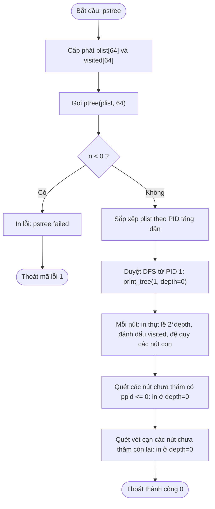
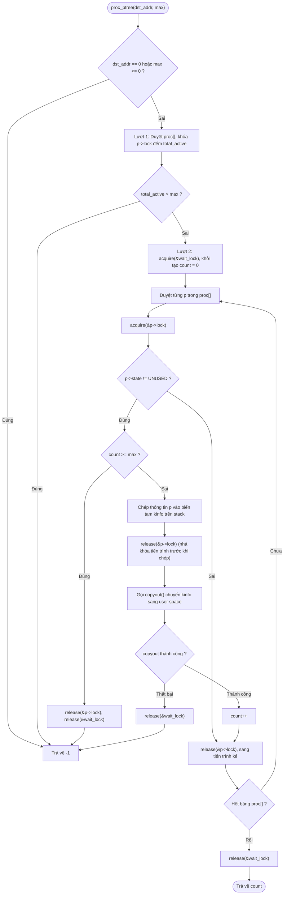

# Báo cáo Thực hành Hệ điều hành: Process Tree

## 3 | Process Tree

### 3.1 Mô tả bài toán

#### 3.1.1 Yêu cầu

Bài thực hành yêu cầu xây dựng tính năng hiển thị cây tiến trình trên hệ điều hành xv6-riscv, giúp người dùng quan sát cấu trúc phân cấp cha - con, trạng thái hoạt động và kích thước không gian địa chỉ người dùng (`p->sz`) của các tiến trình trong hệ thống. Gồm hai phần chính:

1. **System call `ptree` trong kernel**: Thu thập thông tin các tiến trình có trạng thái khác `UNUSED` trong bảng `proc[]`, chuyển vào bộ đệm do chương trình người dùng cung cấp kèm sức chứa tối đa `max`. Kernel không trực tiếp in dữ liệu ra màn hình.
2. **Chương trình người dùng `pstree`**: Gọi system call `ptree`, phân tích liên kết cha - con dựa trên `ppid`, sắp xếp và in ra màn hình dạng cây phân cấp với mức thụt lề 2 khoảng trắng cho mỗi cấp.

**Cấu trúc dữ liệu `struct ptreeinfo`**:
Được định nghĩa trong `kernel/ptree.h` để dùng chung giữa kernel và user space:

| Tên trường | Kiểu dữ liệu | Kích thước | Ý nghĩa kỹ thuật | Nguồn dữ liệu từ `struct proc` |
|---|---|---|---|---|
| `pid` | `int` | 4 bytes | Mã định danh tiến trình | `p->pid` |
| `ppid` | `int` | 4 bytes | Mã định danh tiến trình cha | `p->parent->pid` (hoặc 0 nếu không có cha) |
| `state` | `int` | 4 bytes | Trạng thái tiến trình | `p->state` (từ `enum procstate`) |
| `memsize` | `uint64` | 8 bytes | Kích thước không gian địa chỉ người dùng theo `p->sz` (bytes) | `p->sz` |
| `name` | `char[16]` | 16 bytes | Tên tiến trình | `p->name` |

*Lưu ý căn lề bộ nhớ*: Do kiến trúc RISC-V 64-bit yêu cầu căn lề 8 bytes cho trường `uint64 memsize`, trình biên dịch tự động chèn 4 bytes padding sau trường `state`. Tổng kích thước thực tế của một cấu trúc là 40 bytes.

**Điều kiện lọc tiến trình**:
Kernel chỉ lấy các tiến trình có trạng thái khác `UNUSED` (`p->state != UNUSED`). Danh sách thu thập bao gồm cả tiến trình `ZOMBIE` (đã kết thúc nhưng cha chưa gọi `wait()`). Các trạng thái tương ứng trong xv6: `USED` (1), `SLEEPING` (2), `RUNNABLE` (3), `RUNNING` (4), `ZOMBIE` (5).

**Phân định ranh giới (Separation of Concerns)**:
Kernel chịu trách nhiệm bảo vệ cấu trúc nội bộ, trích xuất dữ liệu an toàn và sao chép sang user space. User space đảm nhiệm việc sắp xếp, liên kết phả hệ và định dạng in ấn.

#### 3.1.2 Đầu vào

- Lệnh thực thi từ shell:
  ```bash
  $ pstree
  ```
- Nguyên mẫu system call: `int ptree(struct ptreeinfo *buf, int max);`
  - `buf`: Con trỏ tới mảng `struct ptreeinfo` do tiến trình người dùng cấp phát (sức chứa `MAX_PROC = 64`).
  - `max`: Số lượng phần tử tối đa mà bộ đệm có thể chứa. Mảng 64 phần tử đáp ứng đầy đủ cả cấu hình chuẩn của xv6 (`NPROC = 64`) lẫn cấu hình bài lab fs (`NPROC = 10`).

#### 3.1.3 Đầu ra và Quy ước giá trị trả về

- **System call `ptree`**:
  - Trả về số lượng tiến trình hợp lệ đã sao chép thành công (`count >= 1`).
  - Trả về `-1` khi: `max <= 0`, con trỏ `buf` là NULL (`dst_addr == 0`), địa chỉ không hợp lệ hoặc không có quyền ghi trong bảng trang, hoặc số tiến trình thực tế lớn hơn `max`.
- **Hành vi xử lý lỗi tại ranh giới**:
  - Khi system call trả về `-1`, kernel không thực hiện thao tác xóa hay hoàn tác (rollback) các bản ghi có thể đã được sao chép trước thời điểm phát sinh lỗi.
  - Chương trình `pstree` kiểm tra giá trị trả về: nếu nhận giá trị âm, chương trình lập tức thông báo lỗi ra stderr và dừng thực thi, không tiếp tục đọc hay in dữ liệu trong bộ đệm.
- **Định dạng hiển thị của tiện ích `pstree`**:
  - In mỗi tiến trình trên một dòng theo định dạng: `<pid> <name> state=<state> mem=<memsize>`.
  - Tiến trình gốc có độ sâu 0. Tiến trình con thụt vào 2 khoảng trắng so với cha. Các tiến trình con cùng cha được xếp theo PID tăng dần.

---

### 3.2 Thuật toán và Thiết kế giải pháp

#### 3.2.1 Ý tưởng 

1. **Bảo vệ ranh giới Kernel - User**: Bảng `proc[NPROC]` nằm trong bộ nhớ kernel, người dùng không thể truy cập trực tiếp. System call `ptree` trích xuất thông tin qua cấu trúc trung gian `struct ptreeinfo` rồi dùng `copyout()` ghi vào bảng trang của tiến trình gọi.
2. **Chiến lược quét hai lượt (Two-pass Scan)**:
   - *Lượt 1 - Đếm số lượng*: Quét bảng `proc[]`, lấy `p->lock` kiểm tra trạng thái khác `UNUSED` để tính tổng số tiến trình `total_active`. Nếu `total_active > max`, trả về `-1` ngay lập tức để từ chối xử lý khi sức chứa không đủ.
   - *Lượt 2 - Thu thập*: Giữ `wait_lock` bảo vệ liên kết cha - con, duyệt lại bảng, sao chép thông tin từng tiến trình vào biến tạm trên stack kernel, nhả `p->lock` rồi mới gọi `copyout()`.
3. **Dựng cây phân cấp bằng DFS trong User Space**:
   - `pstree` nhận mảng phẳng từ kernel, sắp xếp theo PID tăng dần.
   - Bắt đầu duyệt đệ quy DFS từ tiến trình gốc PID 1 (`init`) bằng hàm `print_tree(pid, depth)`. Mỗi bước in thông tin với độ thụt lề tương ứng, đánh dấu `visited`, sau đó đệ quy tìm các tiến trình có `ppid == pid` với `depth + 1`.
   - Cơ chế quét phòng thủ: Quét thêm các tiến trình có `ppid <= 0` và các nút chưa được thăm để bảo đảm hiển thị đầy đủ mọi bản ghi do kernel cung cấp, kể cả khi có nút không nối được vào nhánh gốc PID 1.

#### 3.2.2 Tiến trình thực thi giải pháp

- Khai báo cấu trúc `struct ptreeinfo` trong `kernel/ptree.h`.
- Đăng ký syscall số hiệu 24 (`SYS_ptree`) trong `kernel/syscall.h`, `kernel/syscall.c`, `kernel/sysproc.c`, `kernel/defs.h`, `user/user.h`, `user/usys.pl` và thêm `$U/_pstree\` vào `Makefile`.
- Hàm `sys_ptree()` trích xuất tham số qua `argaddr(0, &addr)` và `argint(1, &max)`, chuyển cho `proc_ptree(addr, max)`.
- Cài đặt `proc_ptree` trong `kernel/proc.c` thực hiện kiểm tra tham số, quét hai lượt, kiểm soát khóa và chép dữ liệu bằng `copyout()`.
- Cài đặt `user/pstree.c` tiếp nhận dữ liệu, xử lý lỗi, sắp xếp và in cây phân cấp.

#### 3.2.3 Lưu đồ hoạt động

##### Lưu đồ 1: Luồng xử lý của tiện ích `user/pstree.c`



##### Lưu đồ 2: Cơ chế thu thập dữ liệu trong Kernel (`proc_ptree`)



---

### 3.3 Những khó khăn và giải pháp kỹ thuật

#### 3.3.1 Thứ tự cấp phát khóa và phòng tránh Deadlock (`wait_lock` và `p->lock`)

- **Vấn đề**: Con trỏ `p->parent` được bảo vệ bởi khóa toàn cục `wait_lock` để đồng bộ khi tiến trình cha gọi `wait()` hoặc tiến trình con gọi `exit()`. Nếu đọc `p->parent` mà không giữ `wait_lock`, quan hệ cha - con có thể bị cập nhật sai lệch hoặc slot tiến trình cha bị tái sử dụng trên lõi khác.
- **Giải pháp**: xv6 quy định thứ tự khóa trong `exit()` và `wait()` là lấy `wait_lock` trước rồi mới lấy `p->lock` của tiến trình con. Để triệt tiêu nguy cơ deadlock ABBA, `proc_ptree` tuân thủ nghiêm ngặt thứ tự này: giữ `wait_lock` ở vòng ngoài trước khi duyệt bảng `proc[]`, sau đó mới lấy `p->lock` cho từng tiến trình, chép dữ liệu sang biến tạm rồi nhả ngay `p->lock`.

#### 3.3.2 Ranh giới vùng tới hạn khi gọi `copyout`

- **Vấn đề**: Hàm `copyout()` thực hiện duyệt bảng trang và sao chép bộ nhớ sang user space. Giữ spinlock `p->lock` trong lúc duyệt bảng trang sẽ vô hiệu hóa ngắt phần cứng trên CPU quá lâu và buộc các lõi khác phải quay vòng chờ (busy-wait) nếu cần truy cập slot `p`.
- **Giải pháp**: Sao chép thông tin tiến trình vào biến tạm `struct ptreeinfo kinfo` trên stack kernel, gọi `release(&p->lock)` ngay lập tức rồi mới thực thi `copyout()`. Thao tác này thu hẹp tối đa thời gian chiếm giữ khóa riêng của từng tiến trình. Khóa `wait_lock` vẫn được giữ trong suốt lượt 2 để bảo đảm cấu trúc phả hệ ổn định.

#### 3.3.3 Tính chất Snapshot không nguyên tử trên SMP và xử lý dữ liệu dở dang

- **Vấn đề**: Trạng thái bảng tiến trình biến động liên tục trên hệ thống đa lõi. Giữa lượt đếm 1 và lượt thu thập 2, tiến trình mới có thể được tạo ra qua `fork()`.
- **Cơ chế xử lý**: Ở lượt 2, kernel kiểm tra `if (count >= max)` trước mỗi lần chép một slot khác `UNUSED`. Do kernel quét tuần tự từ slot 0 đến `NPROC-1`, tiến trình mới chỉ kích hoạt chốt chặn này nếu nó nằm ở slot phía sau vị trí con trỏ quét hiện tại; nếu rơi vào slot phía trước đã duyệt qua khi còn `UNUSED`, lượt quét hiện tại sẽ bỏ qua tiến trình đó.
- **Hiện tượng Partial Write**: Khi việc sao chép bị dừng giữa chừng (do vượt quá `max` ở lượt 2 hoặc do `copyout` lỗi), kernel không hoàn tác các byte đã ghi vào bộ đệm user trước đó. Tính an toàn được bảo đảm tại tầng ứng dụng: tiện ích `pstree` kiểm tra mã lỗi trả về của syscall, nếu `n < 0` sẽ dừng ngay và báo lỗi, không đọc hay in nội dung bộ đệm dở dang.

#### 3.3.4 Cơ chế quét phòng thủ trong User Space

- **Vấn đề**: Nếu chỉ duyệt đệ quy DFS thuần túy từ gốc `init` (PID 1), các tiến trình có `ppid <= 0` hoặc các nút bị cô lập khỏi nhánh chính do sai lệch dữ liệu sẽ bị bỏ sót.
- **Giải pháp**: Cài đặt cơ chế quét ba tầng trong `user/pstree.c`: (1) Duyệt DFS đệ quy từ `init` (PID 1); (2) Quét bổ sung các nút chưa thăm có `ppid <= 0` ở mức gốc (`depth = 0`); (3) Quét vét cạn mọi nút còn lại chưa được đánh dấu `visited`. Nhờ đó, toàn bộ bản ghi do kernel trả về đều được hiển thị đầy đủ.

---

### 3.4 Thực nghiệm và Kết quả kiểm thử

Tiện ích `pstree` và system call `ptree` đã được biên dịch và kiểm thử trực tiếp trên môi trường giả lập QEMU kiến trúc RISC-V 64-bit của hệ điều hành xv6. Báo cáo phân định rõ ràng giữa hai nhóm kết quả: các kịch bản thực thi trực tiếp trên QEMU quan sát được từ giao diện shell, và các ca kiểm thử biên an toàn được xác nhận dựa trên luồng điều khiển mã nguồn.

#### 3.4.1 Kịch bản 1: Cây tiến trình chuẩn từ shell khởi động

- **Thao tác**: Khởi động xv6, chạy lệnh `pstree` tại shell mặc định.
- **Kết quả**:
  ```bash
  $ pstree
  1 init state=2 mem=12288
    2 sh state=2 mem=16384
      3 pstree state=4 mem=20480
  ```
- **Cấu trúc tiến trình**:
  - `1 init state=2 mem=12288`: Tiến trình gốc (PID 1, PPID 0), mức thụt lề 0 (cấp gốc), trạng thái `SLEEPING` (2 - đang ngủ chờ tiến trình con qua hàm `wait()`), không gian địa chỉ người dùng `p->sz` là 12288 bytes (3 trang nhớ ảo).
  - `  2 sh state=2 mem=16384`: Shell cha (PID 2, PPID 1), con của `init`, thụt lề 2 khoảng trắng (cấp 1), trạng thái `SLEEPING` (2 - đang chờ nhập lệnh từ console), không gian địa chỉ 16384 bytes (4 trang).
  - `    3 pstree state=4 mem=20480`: Tiến trình con thực thi tiện ích `pstree` (PID 3, PPID 2), con của `sh`, thụt lề 4 khoảng trắng (cấp 2), trạng thái `RUNNING` (4 - đang chạy trên CPU để quét và in cây tiến trình), không gian địa chỉ 20480 bytes (5 trang).
- **Nhận xét**: Cây tiến trình hiển thị đúng 3 cấp phân nhánh theo cấu trúc DFS. Mức thụt lề 2 khoảng trắng cho mỗi thế hệ giúp phân biệt trực quan thứ bậc phả hệ. Các trạng thái và kích thước không gian địa chỉ phản ánh chính xác trạng thái thực thi tại thời điểm quét.

#### 3.4.2 Kịch bản 2: Cây tiến trình nhiều cấp với Subshell lồng nhau

- **Thao tác**: Mở một subshell con từ shell hiện tại (`sh`) rồi thực thi lệnh `pstree`.
- **Kết quả**:
  ```bash
  $ sh
  $ pstree
  1 init state=2 mem=12288
    2 sh state=2 mem=16384
      3 sh state=2 mem=16384
        4 pstree state=4 mem=20480
  ```
- **Cấu trúc tiến trình**:
  - `1 init state=2 mem=12288`: Tiến trình gốc của hệ thống (PID 1, mức 0).
  - `  2 sh state=2 mem=16384`: Shell cha khởi tạo ban đầu từ `init` (PID 2, con của `init`, mức 1, thụt 2 khoảng trắng).
  - `    3 sh state=2 mem=16384`: Subshell con được khởi chạy từ shell cha (PID 3, con của `sh` PID 2, mức 2, thụt 4 khoảng trắng), trạng thái `SLEEPING` chờ nhập lệnh.
  - `      4 pstree state=4 mem=20480`: Tiến trình con thực thi lệnh `pstree` (PID 4, con của subshell PID 3, mức 3, thụt 6 khoảng trắng), trạng thái `RUNNING` trên CPU.
- **Nhận xét**: Thuật toán DFS xử lý hoàn hảo chuỗi liên kết phả hệ 4 thế hệ qua subshell lồng nhau. Mức thụt lề tăng đều đặn 2 khoảng trắng qua từng cấp thế hệ, bảo đảm tính trực quan và chính xác khi cây tiến trình mở rộng độ sâu.

#### 3.4.3 Các ca kiểm thử biên và xử lý lỗi

Các trường hợp biên và luồng bắt lỗi của system call `ptree` được kiểm chứng qua phân tích mã nguồn và thực nghiệm:

- **TC-01 (Cây cơ bản)**: Chạy `pstree` tại shell mặc định. DFS duyệt từ PID 1 theo `ppid`, in đúng 3 cấp (`init` -> `sh` -> `pstree`). Kết quả: Đạt (QEMU).
- **TC-02 (Subshell lồng nhau)**: Chạy `pstree` trong subshell con. DFS phân nhánh chính xác 4 thế hệ. Kết quả: Đạt (QEMU).
- **TC-03 (Tham số max âm)**: Gọi `ptree(buf, -1)`. Nhánh kiểm tra `max <= 0` chặn sớm và trả về `-1`. Kết quả: Đạt (kiểm chứng mã).
- **TC-04 (Tham số max bằng 0)**: Gọi `ptree(buf, 0)`. Nhánh kiểm tra `max <= 0` trả về `-1`. Kết quả: Đạt (kiểm chứng mã).
- **TC-05 (Con trỏ NULL)**: Gọi `ptree(0, 64)`. Nhánh kiểm tra `dst_addr == 0` trả về `-1`, chặn dereference địa chỉ rỗng. Kết quả: Đạt (kiểm chứng mã).
- **TC-06a (Thiếu bộ đệm ở lượt quét 1)**: Gọi `ptree(buf, max)` khi `total_active > max`. Kernel dừng trước khi copy và trả về `-1`, bảo vệ vùng nhớ user. Kết quả: Đạt (kiểm chứng mã).
- **TC-06b (Tràn bộ đệm do race condition trên SMP)**: Tiến trình mới xuất hiện ở slot chưa duyệt tại lượt quét 2 khi `count >= max`. Chốt chặn ngắt quét và trả về `-1`. Kết quả: Đạt (phân tích mã).
- **TC-07 (Địa chỉ user không hợp lệ)**: Vùng nhớ `buf` ngoài bảng trang hoặc thiếu cờ `PTE_W`. Hàm `copyout` trả về `-1`, kernel nhả `wait_lock` an toàn. Kết quả: Đạt (kiểm chứng mã).

---

### 3.5 Kết luận

- **Tổng kết giải pháp**:
  Bài thực hành đã hoàn thành việc thiết kế và cài đặt tính năng Process Tree trên hệ điều hành xv6-riscv. Tiện ích `pstree` đã được thực nghiệm thành công trên môi trường QEMU, hiển thị chính xác cây tiến trình phân cấp dạng DFS từ shell gốc và qua nhiều lớp subshell lồng nhau. Giải pháp phân định ranh giới chặt chẽ giữa kernel space (trích xuất và bảo vệ dữ liệu đồng thời qua system call `ptree`) và user space (sắp xếp, dựng cây phân cấp và định dạng hiển thị).

- **Các bài học**:  
   - *Nguyên tắc phân cấp khóa trong Kernel*: Hiểu rõ vai trò của `wait_lock` trong việc bảo vệ cấu trúc quan hệ phả hệ tiến trình, tuân thủ thứ tự lấy `wait_lock` trước `p->lock` để phòng tránh nguy cơ deadlock ABBA với `exit()` và `wait()`.  
   - *Tối ưu hóa thời gian giữ spinlock*: Giải phóng sớm khóa riêng `p->lock` của từng tiến trình bằng cách đệm dữ liệu sang stack kernel trước khi gọi `copyout()`.  
   - *Lập trình và kiểm soát bộ đệm*: Áp dụng chiến lược quét hai lượt để kiểm soát sức chứa, đặt chốt chặn thời gian thực `count >= max` ngăn tràn bộ đệm trên hệ thống SMP, và xây dựng cơ chế quét ba tầng phía user space để bảo đảm không thất lạc bản ghi.


