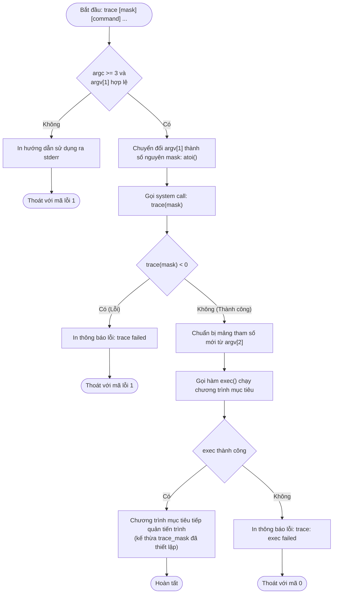
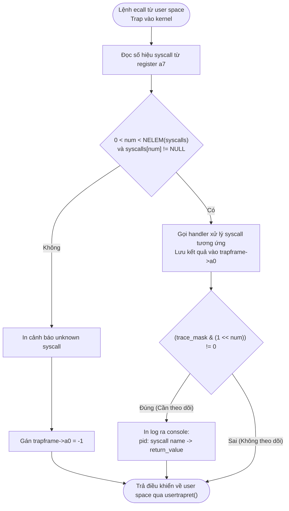

# Báo cáo Thực hành Hệ điều hành: System Call Trace

## 1 | System call Trace

### 1.1 Mô tả bài toán

#### 1.1.1 Yêu cầu
System call là giao diện giao tiếp chuẩn giữa user space và kernel. Nhằm hỗ trợ debug và kiểm thử hoạt động của hệ điều hành, bài toán yêu cầu xây dựng tính năng theo dõi system call linh hoạt:
- **Xây dựng system call `trace`**: Nhận một số nguyên `mask`. Mỗi bit thứ $i$ trong `mask` khi được bật (giá trị 1) biểu thị việc theo dõi syscall có index $i$ tương ứng.
- **Ghi log trong kernel**: Khi một tiến trình thực thi một syscall nằm trong `mask`, kernel sẽ in ra một dòng log theo định dạng:
  ```text
  <pid>: syscall <tên_syscall> -> <giá_trị_trả_về>
  ```
  Trong đó:
  - `<pid>`: ID của tiến trình đang thực thi.
  - `<tên_syscall>`: Tên định danh của syscall.
  - `<giá_trị_trả_về>`: Giá trị trả về sau khi syscall hoàn tất.
- **Lưu ý**:
  - `trace_mask` phải được tự động sao chép sang các tiến trình con được tạo thông qua `fork()`.
  - Tiến trình được theo dõi hoàn toàn cô lập, không làm ảnh hưởng đến hành vi hay đầu ra của các tiến trình khác trong hệ thống.
- **Chương trình user `trace`**: Cung cấp tiện ích dòng lệnh `trace <mask> <command> [args...]` cho phép người dùng khởi chạy bất kỳ chương trình nào kèm theo chế độ theo dõi mong muốn.

#### 1.1.2 Input
- **Cú pháp dòng lệnh**:
  ```bash
  $ trace <mask> <command> [args...]
  ```
  - `mask`: Số nguyên biểu diễn bitmask (hệ thập phân). Ví dụ: `32` ứng với $1 \ll 5$ (`SYS_read`), `2147483647` ứng với việc bật toàn bộ 31 bit thấp để theo dõi tất cả syscall.
  - `<command>`: Tên chương trình mục tiêu cần chạy và các đối số đi kèm.
- **Prototype API trong user space**:
  ```c
  int trace(int mask);
  ```

#### 1.1.3 Output
- Thông tin log được kernel xuất trực tiếp ra console ngay khi syscall hoàn tất.
- Không in log đối với các syscall không được bật trong `mask`, hoặc khi chạy các chương trình thông thường không gọi `trace`.

---

### 1.2 Thuật toán và Thiết kế giải pháp

#### 1.2.1 Ý tưởng cốt lõi và Cơ sở thiết kế

1. **Quản lý trạng thái theo dõi trong `struct proc`**:
   Mỗi tiến trình có thể theo dõi một tập syscall khác nhau. Nếu dùng biến toàn cục (global), cấu hình của tiến trình này sẽ ghi đè lên tiến trình khác. Vì vậy ta phải lưu trace_mask trực tiếp vào struct proc (cấu trúc dữ liệu đại diện cho từng tiến trình trong kernel). Nhờ đó, mỗi tiến trình sở hữu một cấu hình riêng biệt, độc lập và an toàn tuyệt đối.

2. **Kế thừa từ `fork()` và bảo toàn qua `exec()`**:
  Lệnh chạy có dạng: trace 32 grep hello README. Ở đây, trace là chương trình khởi đầu, còn grep mới là chương trình ta thực sự cần theo dõi. Cơ chế này tận dụng đúng cách hoạt động của exec và fork:
   - **`fork()`**: Sau khi gọi syscall trace(mask) để nạp mask vào chính mình, tiện ích trace gọi exec() để nạp chương trình mục tiêu (grep). Vì exec chỉ thay thế mã thực thi trong user space nhưng giữ nguyên struct proc trong kernel, nên chương trình grep tự động kế thừa trace_mask mà không cần bất kỳ cơ chế truyền tin phức tạp nào.
   - **`exec()`**: Khi một tiến trình tạo tiến trình con bằng fork(), kernel chỉ cần sao chép giá trị np->trace_mask = p->trace_mask. Toàn bộ cây tiến trình con cháu sinh ra đều tự động được theo dõi.

3. **Chặn bắt tại trap dispatcher (`syscall()`)**:
   Mọi syscall từ user space khi trap vào kernel đều phải đi qua duy nhất một hàm điều phối là syscall().
   Thay vì can thiệp vào từng syscall riêng lẻ, ta chỉ cần đặt logic kiểm tra ở ngay sau khi syscall handler chạy xong:
    1. Handler thực thi xong và lưu kết quả vào thanh ghi a0.
    2. Kernel kiểm tra phép tính bit: (p->trace_mask & (1 << num)).
    3. Nếu bit tương ứng bằng 1, kernel tra cứu tên syscall trong bảng syscall_names rồi in dòng log chuẩn: <pid>: syscall <tên> -> <giá trị a0>.

---

#### 1.2.2 Tiến trình xây dựng và thực thi giải pháp

#### Bước 1: Khai báo giao diện System Call (User $\leftrightarrow$ Kernel)
* **`kernel/syscall.h`**: Định nghĩa số hiệu syscall mới: `#define SYS_trace 22`.
* **`user/user.h`**: Khai báo prototype hàm cho user space: `int trace(int);`.
* **`user/usys.pl`**: Thêm `entry("trace");` để script tự động sinh mã assembly gọi lệnh ngắt `ecall` sang kernel.

#### Bước 2: Lưu trữ và quản lý vòng đời `trace_mask`
* **`kernel/proc.h`**: Bổ sung trường `int trace_mask;` vào `struct proc` để mỗi tiến trình lưu một mask riêng.
* **`kernel/proc.c`**:
  * Khi tạo tiến trình mới (`allocproc`): Gán `trace_mask = 0` để tránh nhận dữ liệu rác từ tiến trình cũ.
  * Khi tạo tiến trình con (`fork`): Sao chép `np->trace_mask = p->trace_mask` để tiến trình con tự động kế thừa cấu hình từ cha.
  * Khi giải phóng tiến trình (`freeproc`): Reset `trace_mask = 0`.

#### Bước 3: Hiện thực handler xử lý (`sys_trace`)
* **`kernel/sysproc.c`**: Viết hàm `sys_trace()`:
  1. Dùng `argint(0, &mask)` để lấy tham số nguyên từ thanh ghi `a0`.
  2. Gán giá trị nhận được vào tiến trình hiện hành: `myproc()->trace_mask = mask;`.
  3. Trả về `0` khi hoàn tất.

#### Bước 4: Kiểm tra mask và in log trong bộ điều phối
* **`kernel/syscall.c`**:
  * Đăng ký handler `[SYS_trace] sys_trace` vào mảng con trỏ hàm `syscalls[]`.
  * Tạo bảng tra cứu `syscall_names[]` để ánh xạ từ số hiệu (như `SYS_read`) sang chuỗi ký tự tương ứng (như `"read"`).
  * Trong hàm `syscall()`: Ngay sau khi syscall được thực thi và có kết quả trong thanh ghi `a0`, kiểm tra điều kiện bit:
    ```c
    if ((p->trace_mask & (1 << num)) != 0) {
        printf("%d: syscall %s -> %d\n", p->pid, syscall_names[num], (int)p->trapframe->a0);
    }
    ```

#### Bước 5: Viết tiện ích user và cấu hình Makefile
* **`user/trace.c`**: 
  1. Đọc và chuyển đổi `argv[1]` thành số nguyên bằng `atoi()`.
  2. Gọi `trace(mask)` để thiết lập mask cho tiến trình hiện tại.
  3. Gọi `exec(argv[2], &argv[2])` để nạp và chạy chương trình mục tiêu (chương trình này tự động mang sẵn `trace_mask`).
* **`Makefile`**: Thêm `$U/_trace` vào danh sách `UPROGS` để trình biên dịch đóng gói tiện ích `trace` vào file image hệ điều hành (`fs.img`).

---

#### 1.2.3 Lưu đồ hoạt động

##### Lưu đồ 1: Luồng thực thi chương trình user `trace`



---

##### Lưu đồ 2: Cơ chế điều phối và ghi log trong kernel (`syscall()`)



---

### 1.3 Những khó khăn gặp phải và giải pháp


### 1. Bỏ sót chính syscall `trace` (Self-tracing)
* **Hiện tượng:** Khi chạy lệnh theo dõi toàn bộ (ví dụ: `trace 2147483647 ...`), log đầu tiên cần xuất hiện là của chính lệnh này: `4: syscall trace -> 0`.
* **Nguyên nhân:** Nếu kiểm tra `trace_mask` **trước** khi chạy `sys_trace()`, lúc này mask của tiến trình vẫn bằng `0`, khiến lệnh `trace` bị bỏ qua và không được in ra.
* **Giải pháp:** Dời bước kiểm tra `(p->trace_mask & (1 << num))` và in log xuống **sau** khi handler `syscalls[num]()` đã chạy xong. Lúc này `sys_trace()` đã kịp nạp `mask` mới vào `struct proc`.

---

### 2. Lỗi format trình biên dịch và hiển thị mã lỗi số âm
* **Hiện tượng:** 
  * Thanh ghi chứa giá trị trả về `p->trapframe->a0` có kiểu `uint64`.
  * Trình biên dịch bật cờ khắt khe `-Werror=format=`: Dùng `%d` sẽ bị compiler báo lỗi; nhưng nếu đổi sang `%lu`, các mã lỗi trả về dạng số âm (như `-1`) sẽ bị in thành số nguyên không dấu 64-bit khổng lồ ($18446744073709551615$).
* **Giải pháp:** Ép kiểu tường minh về số nguyên: `(int)p->trapframe->a0` khi in với định dạng `%d`. Cách này vừa triệt tiêu cảnh báo của compiler, vừa in chính xác các giá trị âm (ví dụ: `-> -1`).

---

### 3. Kế thừa và cô lập `trace_mask` qua các tiến trình
* **Hiện tượng:**
  * **Mất dấu vết:** `exec()` vẫn giữ nguyên `struct proc` nên mask không bị mất, nhưng `fork()` lại cấp phát một `struct proc` mới cho tiến trình con. Nếu không sao chép mask, các tiến trình con/cháu sẽ mất hoàn toàn tính năng theo dõi.
  * **Rò rỉ dữ liệu:** Nếu không dọn dẹp khi tiến trình kết thúc, tiến trình mới tái sử dụng lại slot `struct proc` cũ có thể bị dính mask rác.
* **Giải pháp:**
  * **Kế thừa:** Thêm dòng `np->trace_mask = p->trace_mask` trong `fork()`.
  * **Cô lập:** Khởi tạo sạch bằng cách gán `p->trace_mask = 0` ở cả hai hàm `allocproc()` (khi cấp phát) và `freeproc()` (khi giải phóng).
---

### 1.4 Kiểm thử (Testing)

Nhóm tiến hành thực nghiệm trên bộ công cụ kiểm thử tự động `grade-lab-syscall` cùng các kịch bản kiểm tra thủ công.

#### 1.4.1 Kịch bản 1: Theo dõi một syscall cụ thể (`trace 32 grep hello README`)
- **Mục đích**: Kiểm tra khả năng lọc chính xác syscall được chỉ định (`32 = 1 << 5` tức `SYS_read`). Các syscall khác như `exec`, `open`, `close` không được phép xuất hiện.
- **Kết quả thực tế**:
  ```text
  $ trace 32 grep hello README
  3: syscall read -> 1023
  3: syscall read -> 966
  3: syscall read -> 70
  3: syscall read -> 0
  ```
- **Nhận xét**: Chỉ có syscall `read` được in ra cùng số byte đọc được; khi kết thúc file đọc trả về 0. Đạt yêu cầu.

#### 1.4.2 Kịch bản 2: Theo dõi toàn bộ syscall (`trace 2147483647 grep hello README`)
- **Mục đích**: Kiểm tra khả năng theo dõi đồng thời tất cả các syscall khi toàn bộ 31 bit thấp được bật.
- **Kết quả thực tế**:
  ```text
  $ trace 2147483647 grep hello README
  4: syscall trace -> 0
  4: syscall exec -> 3
  4: syscall open -> 3
  4: syscall read -> 1023
  4: syscall read -> 966
  4: syscall read -> 70
  4: syscall read -> 0
  4: syscall close -> 0
  ```
- **Nhận xét**: Log ghi nhận đầy đủ chu trình từ khởi tạo `trace`, nạp chương trình qua `exec`, mở file `open`, đọc dữ liệu `read` đến khi kết thúc bằng `close`.

#### 1.4.3 Kịch bản 3: Không kích hoạt theo dõi (`grep hello README`)
- **Mục đích**: Đảm bảo hệ thống không in log khi chạy các lệnh thông thường không thông qua `trace`.
- **Kết quả thực tế**:
  ```text
  $ grep hello README
  $
  ```
- **Nhận xét**: Không có bất kỳ dòng log nào xuất hiện, chứng minh tính cô lập hoàn toàn giữa các tiến trình.

#### 1.4.4 Kịch bản 4: Kế thừa theo dõi qua các thế hệ tiến trình con (`trace 2 usertests forkforkfork`)
- **Mục đích**: Kiểm tra việc kế thừa qua nhiều cấp `fork()` (`2 = 1 << 1` tức `SYS_fork`).
- **Kết quả thực tế**:
  ```text
  $ trace 2 usertests forkforkfork
  usertests starting
  test forkforkfork: 407: syscall fork -> 408
  408: syscall fork -> 409
  409: syscall fork -> 410
  410: syscall fork -> 411
  ...
  411: syscall fork -> -1
  OK
  ```
- **Nhận xét**: Tất cả tiến trình con cháu sinh ra đều tự động kế thừa `trace_mask` và in log khi gọi `fork()`. Khi bảng tiến trình đạt giới hạn cực đại, giá trị `-1` được hiển thị chính xác.

#### 1.4.5 Kết quả chấm điểm tự động (`grade-lab-syscall`)
Toàn bộ testcase trong bộ chấm điểm đều vượt qua:
```text
== Test trace 32 grep == trace 32 grep: OK (1.1s) 
== Test trace close grep == trace close grep: OK (0.6s) 
== Test trace exec + open grep == trace exec + open grep: OK (1.0s) 
== Test trace all grep == trace all grep: OK (1.1s) 
== Test trace nothing == trace nothing: OK (0.8s) 
== Test trace children == trace children: OK (23.0s) 
```

---

### 1.5 Kết luận

- Nhóm đã hoàn thành việc triển khai system call `trace` trên hệ điều hành xv6-riscv, đáp ứng đầy đủ các tiêu chí kỹ thuật và vượt qua 100% các bài kiểm thử.
- **Kiến thức đúc kết**:
  - Nắm vững chu trình kích hoạt và điều phối của system call từ user space qua lệnh `ecall` vào kernel trap handler.
  - Hiểu rõ cơ chế quản lý dữ liệu tiến trình thông qua `struct proc`, cách kernel duy trì trạng thái khi gọi `exec()` và kế thừa ngữ cảnh khi gọi `fork()`.
  - Thành thạo việc xử lý giá trị trả về, kiểm soát kiểu dữ liệu và định dạng đầu ra an toàn trong môi trường kernel.
