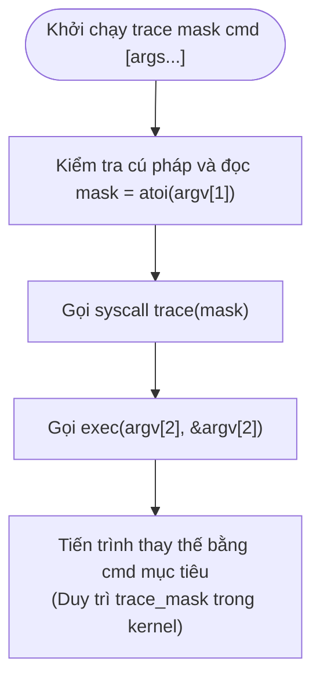
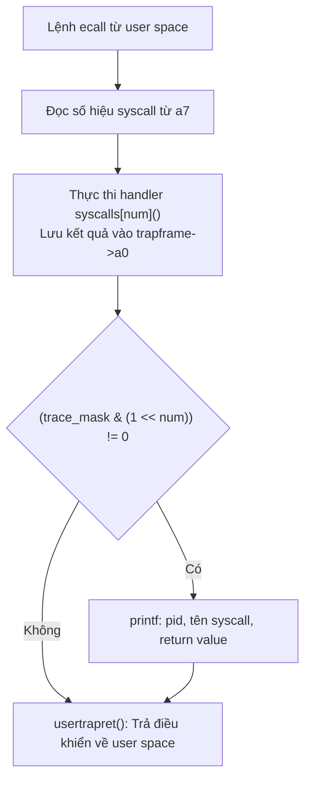

# Báo cáo: Triển khai System Call Trace trong xv6

## 1. Yêu cầu bài toán

- **Mục tiêu**: Bổ sung system call `trace` cho xv6 nhằm theo dõi việc thực thi các system call của một tiến trình và các tiến trình con của nó.
- **Giao diện user space**:
  - System call: `int trace(int mask);`
  - Tiện ích dòng lệnh: `trace <mask> <command> [args...]`
- **Cơ chế lọc (Bitmask)**: 
  - Tham số `mask` là số nguyên; bit thứ $i$ (bắt đầu từ 1) tương ứng với số hiệu syscall `SYS_*` được định nghĩa trong `kernel/syscall.h`.
  - Kernel chỉ in log đối với các syscall có bit tương ứng trong `mask` mang giá trị 1.
- **Định dạng log**:
  ```text
  <pid>: syscall <tên_syscall> -> <giá_trị_trả_về>
  ```
  Trong đó giá trị trả về lấy từ thanh ghi `a0` của trapframe sau khi syscall hoàn tất.
- **Kế thừa tiến trình**: Tiến trình con sinh ra từ `fork()` tự động kế thừa `trace_mask` từ tiến trình cha. Lời gọi `exec()` giữ nguyên `trace_mask`.

---

## 2. Thiết kế và Hiện thực

### 2.1 Cấu trúc dữ liệu và Quản lý vòng đời (`kernel/proc.h`, `kernel/proc.c`)

- Bổ sung trường lưu trữ bitmask vào `struct proc`:
  ```c
  struct proc {
    ...
    int trace_mask;              // Bitmask các syscall cần theo dõi
  };
  ```
- Quản lý trạng thái qua các giai đoạn của tiến trình trong `kernel/proc.c`:
  - `allocproc()`: Khởi tạo `p->trace_mask = 0;` khi cấp phát tiến trình mới.
  - `freeproc()`: Reset `p->trace_mask = 0;` khi giải phóng tiến trình để tránh sót dữ liệu sang tiến trình tái sử dụng slot `struct proc`.
  - `fork()`: Sao chép cấu hình theo dõi sang tiến trình con: `np->trace_mask = p->trace_mask;`.

### 2.2 System Call Handler (`kernel/sysproc.c`)

Hiện thực handler `sys_trace()` xử lý yêu cầu từ user space:

```c
uint64
sys_trace(void)
{
  int mask;
  if(argint(0, &mask) < 0)
    return -1;
  myproc()->trace_mask = mask;
  return 0;
}
```

### 2.3 Điều phối và Xuất log (`kernel/syscall.h`, `kernel/syscall.c`)

1. **Định nghĩa mã và bảng tra cứu**:
   - Khai báo `#define SYS_trace 22` trong `kernel/syscall.h`.
   - Đăng ký `[SYS_trace] sys_trace` vào mảng con trỏ hàm `syscalls[]`.
   - Xây dựng mảng ánh xạ tên syscall `syscall_names[]`:
     ```c
     static char *syscall_names[] = {
       [SYS_fork]    "fork",
       [SYS_exit]    "exit",
       [SYS_wait]    "wait",
       [SYS_pipe]    "pipe",
       [SYS_read]    "read",
       [SYS_kill]    "kill",
       [SYS_exec]    "exec",
       [SYS_fstat]   "fstat",
       [SYS_chdir]   "chdir",
       [SYS_dup]     "dup",
       [SYS_getpid]  "getpid",
       [SYS_sbrk]    "sbrk",
       [SYS_sleep]   "sleep",
       [SYS_uptime]  "uptime",
       [SYS_open]    "open",
       [SYS_write]   "write",
       [SYS_mknod]   "mknod",
       [SYS_unlink]  "unlink",
       [SYS_link]    "link",
       [SYS_mkdir]   "mkdir",
       [SYS_close]   "close",
       [SYS_trace]   "trace",
     };
     ```

2. **Kiểm tra mask và xuất log trong hàm `syscall()`**:
   Sau khi handler hoàn tất việc ghi kết quả vào `trapframe->a0`, kernel kiểm tra bitmask và in log nếu syscall nằm trong danh sách theo dõi:
   ```c
   void
   syscall(void)
   {
     int num;
     struct proc *p = myproc();

     num = p->trapframe->a7;
     if(num > 0 && num < NELEM(syscalls) && syscalls[num]) {
       p->trapframe->a0 = syscalls[num]();
       if((p->trace_mask & (1 << num)) != 0) {
         printf("%d: syscall %s -> %d\n",
                p->pid, syscall_names[num], (int)p->trapframe->a0);
       }
     } else {
       ...
     }
   }
   ```

### 2.4 Giao diện User space (`user/user.h`, `user/usys.pl`, `user/trace.c`)

- Khai báo `int trace(int);` trong `user/user.h`.
- Thêm `entry("trace");` vào `user/usys.pl` để sinh mã stub kích hoạt lệnh `ecall`.
- Xây dựng tiện ích `user/trace.c`:
  ```c
  #include "kernel/types.h"
  #include "kernel/stat.h"
  #include "user/user.h"

  int
  main(int argc, char *argv[])
  {
    if(argc < 3){
      fprintf(2, "Usage: trace mask command [args...]\n");
      exit(1);
    }

    int mask = atoi(argv[1]);
    if(trace(mask) < 0){
      fprintf(2, "trace: failed to set mask\n");
      exit(1);
    }

    exec(argv[2], &argv[2]);
    fprintf(2, "trace: exec %s failed\n", argv[2]);
    exit(1);
  }
  ```

---

### 2.5 Lưu đồ hoạt động

#### Luồng thực thi tiện ích `user/trace.c`



#### Luồng điều phối và ghi log trong `kernel/syscall.c`



---

## 3. Các lưu ý kỹ thuật (Implementation Details)

1. **Vị trí kiểm tra mask trong `syscall()`**:
   Điều kiện `(p->trace_mask & (1 << num))` phải được đặt **sau** khi handler `syscalls[num]()` đã chạy xong. Nếu đặt trước, khi tiến trình gọi `trace(mask)` lần đầu, `trace_mask` trong `struct proc` tại thời điểm đó vẫn bằng 0, dẫn đến bỏ sót dòng log của chính syscall `trace`.

2. **Ép kiểu giá trị trả về của thanh ghi `a0`**:
   Thanh ghi `p->trapframe->a0` có kiểu số nguyên không dấu 64-bit (`uint64`). Nếu không ép kiểu về `(int)`:
   - Trình biên dịch GCC trên RISC-V sẽ báo lỗi `-Werror=format` khi dùng định dạng `%d`.
   - Nếu đổi sang `%lu`, các mã lỗi trả về dạng số âm (như `-1`) sẽ bị in thành giá trị `18446744073709551615`, vi phạm định dạng đầu ra.

3. **Bảo toàn và cô lập trạng thái tiến trình**:
   - `trace_mask` được lưu độc lập trong từng `struct proc`. Khi tiến trình gọi `fork()`, kernel sao chép trực tiếp giá trị này sang tiến trình con.
   - Khi gọi `exec()`, không gian bộ nhớ user space bị thay thế nhưng cấu trúc `struct proc` trong kernel vẫn được giữ nguyên, đảm bảo chương trình mục tiêu kế thừa toàn vẹn cấu hình theo dõi.

---

## 4. Kết quả kiểm thử

### 4.1 Theo dõi một syscall cụ thể (`SYS_read`)

```text
$ trace 32 grep hello README
3: syscall read -> 1023
3: syscall read -> 966
3: syscall read -> 70
3: syscall read -> 0
```
*Đánh giá:* Với `mask = 32` (`1 << 5`), kernel chỉ lọc và in các lời gọi `read`. Các syscall khác (`exec`, `open`, `close`) không bị ghi log.

### 4.2 Theo dõi toàn bộ syscall (`mask = 2147483647`)

```text
$ trace 2147483647 grep hello README
4: syscall trace -> 0
4: syscall exec -> 3
4: syscall open -> 3
4: syscall read -> 1023
4: syscall read -> 966
4: syscall read -> 70
4: syscall read -> 0
4: syscall close -> 0
```
*Đánh giá:* Ghi nhận đầy đủ chu trình thực thi từ khi thiết lập `trace`, nạp binary bằng `exec`, đọc dữ liệu đến khi đóng file bằng `close`.

### 4.3 Chạy thông thường không kích hoạt trace

```text
$ grep hello README
$
```
*Đánh giá:* Không xuất hiện log, đảm bảo tính cô lập giữa các tiến trình không được chỉ định theo dõi.

### 4.4 Kế thừa qua nhiều cấp tiến trình con (`trace 2 usertests forkforkfork`)

```text
$ trace 2 usertests forkforkfork
usertests starting
test forkforkfork: 407: syscall fork -> 408
408: syscall fork -> 409
409: syscall fork -> 410
410: syscall fork -> 411
...
411: syscall fork -> -1
OK
```
*Đánh giá:* Tiến trình con qua các cấp `fork()` tự động kế thừa `trace_mask`. Khi bảng tiến trình đầy, mã lỗi `-1` hiển thị chính xác.

### 4.5 Kết quả chấm điểm tự động (`grade-lab-syscall`)

```text
== Test trace 32 grep == trace 32 grep: OK (1.1s) 
== Test trace close grep == trace close grep: OK (0.6s) 
== Test trace exec + open grep == trace exec + open grep: OK (1.0s) 
== Test trace all grep == trace all grep: OK (1.1s) 
== Test trace nothing == trace nothing: OK (0.8s) 
== Test trace children == trace children: OK (23.0s) 
```

---

## 5. Kết luận

Tính năng system call `trace` đã được hiện thực hoàn chỉnh trên hệ điều hành xv6-riscv, đáp ứng đúng đặc tả kỹ thuật, đảm bảo tính cô lập và kế thừa giữa các tiến trình, đồng thời vượt qua toàn bộ các bài kiểm thử trong bộ testcase tự động.
